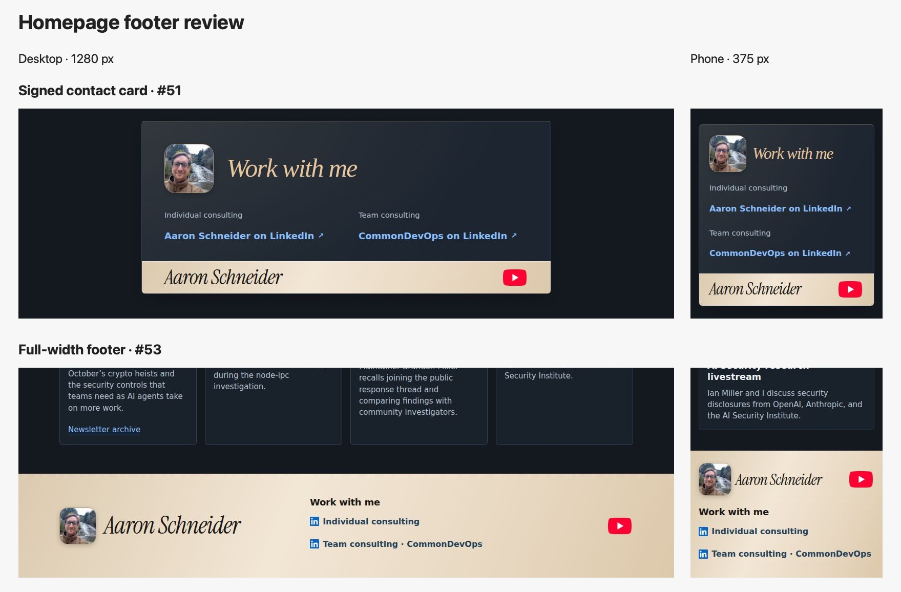

# Portfolio roadmap

## Portfolio goal and release history

Serve employers and consulting clients through a portfolio of career experience, project stories, and publications.

The standing scrum team includes a UI/UX specialist, a graphic designer and professional writers alongside product, project management, engineering and QA. At planning, UX traces the visitor’s task, design defines the visual hierarchy and the writers identify the evidence for each claim. At sprint review they walk the released journey together on phone and desktop.

- Career reconciliation and separate image attribution: approved by Aaron on October 26, 2026.
- Four main pages, PGP utility, six project cards, and six publication links: implemented locally.
- Local build and validation: passed, including navigation, assets, contact restrictions, and unchanged PGP key.
- Preview review and publication: approved by Aaron on October 26, 2026.
- MVP release: published through PR #1; the YouTube subscription button followed in PR #2. Live domains, pages, images, and the unchanged PGP key were verified.
- The charcoal-and-blue design and manual edits through `4b3ad29` merged in [PR #3](https://github.com/schneidergithub/schneidergithub.github.io/pull/3), including removal of education and certifications from the Experience page. [PR #4](https://github.com/schneidergithub/schneidergithub.github.io/pull/4) added versioned stylesheet and favicon URLs.

## Sprint review and proposed next three sprints

The simulated review covered the 14 portfolio pages, including all seven case studies. Marketing and the writer followed hiring and consulting journeys. Graphic design compared release captures at 375px and 1280px. UX and engineering reviewed navigation, keyboard behavior, media and the templates that repeat across pages. The findings describe what the team could see and reproduce. Visitor conversion has not been measured.

### Restore the personal invitation

[Open the comparison at full size](reviews/home-footer-comparison.jpg) · [Signed card, release 51](https://github.com/schneidergithub/schneidergithub.github.io/pull/51) · [Full-width footer, release 53](https://github.com/schneidergithub/schneidergithub.github.io/pull/53)

| Perspective | What changed | Design decision to preview |
| --- | --- | --- |
| Graphic design | Both releases use Instrument Serif Italic and the same near-black ink, `#191613`. In the card, the name signs a narrow champagne strip. In the band, it sits beside the face. The desktop portrait shrank from 96px to 72px and “Work with me” became a small, bold utility heading. | Return to the centered charcoal card, larger portrait and champagne italic invitation. Put the name back on a shallow strip. Compare the original ink with a warm dark brown in that setting before changing the typeface. |
| Marketing and writing | The former card asks one clear question of the visitor. On a phone, the new band places the red channel icon beside the portrait before either consulting route. On desktop, a wide gap separates that icon from the invitation. | Keep “Individual consulting” and “Team consulting · CommonDevOps” as the two actions below the invitation. Use the official LinkedIn marks with each link. Pair the YouTube mark with the signature at the end. |
| UX and QA | Both releases passed functional checks. The checks verify destinations and focus, but link count and word count do not say whether visitors see the invitation first. | Compare both screen sizes at their actual display size. A fresh reviewer should identify the two recipients and point to the channel from the closed page. Tab through individual, team, then channel. Preserve both existing bookmarks, three unique destinations, 44px targets and reflow at 320px with enlarged text. |

The recommendation concerns the homepage. Keep the compact interior footers, and resolve adjacent duplicate contacts in the case-study template. The editorial masthead and project contact sheet are reviewed separately in [PR 52](https://github.com/schneidergithub/schneidergithub.github.io/pull/52). During that review, a 375px capture showed “Articles & Demos” alone on the last menu row. The reviewed revision gives four links two balanced rows and checks them in the browser.

### Sprint goals

| Order | Visitor outcome and scope | Review and acceptance |
| --- | --- | --- |
| 1 · Contact | Restore the signed homepage card using the layout above. On all seven case studies, the closing navigation offers Aaron’s LinkedIn and the adjacent footer immediately repeats it. Preserve a clear project-return link and provide one route to the individual and team choices on Home. | Starting from a shared case, reach the correct personal or company profile and return to that project summary. Inspect the card on desktop and phone, with keyboard focus and enlarged text. Capture the resting layout beside the signed-card baseline for visual acceptance. |
| 2 · Project evidence | The illustrated homepage leads to a text-heavy Work index. At 375px the captured first viewport shows section links and seven case titles before a project image. Bring one recognizable artifact and outcome into that view. Aaron selected the two-phone Guest Pass salon finder for the Super Salon homepage card. Connect the Bucky Ball and Berkeley experience entries to the matching site and inventory galleries. | From the Work landing page, identify one contribution before scrolling at 375×812 and open the associated case. Retain the seven direct case links and gallery bookmarks. At phone size, the two Guest Pass phones should be distinguishable and the card should open the checkout case. For Westinghouse, add a test decision only if an existing source supports it. |
| 3 · Reading, viewing and sharing | In Articles & Demos, the essay title wraps to four lines beside its permalink on a 375px phone. Give the title more width. Feature the signed essay in one of the two homepage slots covering the same node-ipc incident. Five cases and the essay use the generic social image. Start with a distinctive, cleared share image for the essay and one case. | Keep the essay’s title within three lines at default 375px, with a keyboard-accessible permalink. Check the two social cards at feed size. Preserve the report and interview in the collection. For the December issue, verify the published LinkedIn headline and cover, latest-issue placement by coverage month, and access to October’s LinkedIn, web and PDF editions. |

At sprint review, the designer and marketing reviewer should inspect the resting page before seeing test results. QA should verify the same journey with a keyboard and enlarged text. This adds a human design decision to the existing production checks. Keep the source-dependent TDD follow-up in the editorial backlog and preserve the approved exclusion of node-ipc editorial revisions.

## Monthly newsletter archive

| Reader story | Implementation and acceptance |
| --- | --- |
| Open the latest CommonDevOps newsletter from Home | Feature the newest published issue by coverage month. Its headline and cover open the individual LinkedIn article. A nearby archive link opens the monthly section of Articles & Demos. |
| Find an earlier issue | Show one cover, month and linked headline per issue, newest first and grouped by year. Keep the existing issue bookmarks and alternate web and PDF editions. The initial archive covers April through October 2026. |
| Find each new issue after publication | For the December publication and each month thereafter, add the published headline, LinkedIn article URL, local cover and alt text, and a short homepage description to a single entry in `_data/publications.yml`. Use `type: "Article"`, a unique year-and-month ID, `issue_month` for the month covered and `date` for the actual publication date. The same entry updates the homepage, archive order, year group and count on deployment. |

## Portfolio polish · Five-sprint release

**Released November 21, 2026.** Five sprints delivered the 13 stories open at kickoff, totaling 50 estimated points. The earlier Bayer showcase accounts for another five points. The goal was to help a hiring manager or technical reader answer three questions quickly. What did Aaron do? What can I see for myself? Where will this link take me? This plan covers the existing portfolio. The team reviewed the four main pages, seven cases and PGP utility, the release captures, and the editorial and article-source material from *Get Video Transcripts*. The grader guide, chess case, and incident investigation are already live. [Production baseline at the start of planning](https://github.com/schneidergithub/schneidergithub.github.io/tree/82c6bcf589c0215a223186ab146aa96908b4c6a5)

| Order | Milestone a visitor can demonstrate | Planned size | Lead |
| --- | --- | ---: | --- |
| 1 | Read the Bayer case once and explain Aaron’s contribution | 13 points | Professional writers and marketing editor |
| 2 | Inspect an original image and return to the same place | 13 points | Graphic designer and UI/UX specialist |
| 3 | Find an engineering result from Home and the right evidence from Articles | 13 points | Product, editorial and frontend |
| 4 | Choose a personal or team contact from a single business card | 8 points | Marketing, visual design and frontend |
| 5 | Read and share a sourced engineering essay | 8 points | Professional writer, technical editor and QA |

At kickoff, the first three milestones had 34 points of open work after the five-point Bayer showcase. The contact card and essay added eight points each. Every sprint includes a marketing reviewer and an independent graphic designer. Marketing follows a named visitor journey. Design compares phone and desktop captures. The team records their decisions and adjusts the upcoming backlog after production verification.

**Approved release scope.** The owner removed the node-ipc editorial clarification from this series. All other stories shipped. Keep inline source links easy to recognize. Give navigation a compact treatment and let a genuine project image stand in for redundant text. At review, compare the Work directory, the gallery and a publication entry on a phone.

### Sprint 1 · Edit the work for a human reader

| Visitor story | Implementation | Acceptance |
| --- | --- | --- |
| Identify who led development of the Aleve website (5) | **Delivered with this plan.** Introduce Aaron as the lead software developer for Aleve.com at Ciber. Show the two original screens immediately below the introduction. Remove the customer-story walkthrough and both visible captions, including the repeated explanation on the gallery cover. | The role is explicit on first read. The two screenshots open at full size, have descriptive alt text, and have no visible caption or empty caption container. The broader Bayer engagement stays available through the project summary. |
| Learn what an engineer actually decided (5) | Review all seven case openings. In Indiana, bring forward the filename failure in the one-county pilot and the repair before the statewide rollout. In Westinghouse, give the load test, configuration change and 3× Elasticsearch result once. In Super Salon, keep the eleven bottles, 15% discount and one-cent difference. | In a read-through, the editor can identify a contribution and an observed result or delivered artifact in each opening. Preserve client and employer attribution, the unit behind each metric, the limitations of the node-ipc evidence, and the distinction between observed and proposed checks in chess. |
| Skim project summaries and Experience without rereading the same claim (3) | Edit the six project summaries. Combine repeated summary, body and outcome fields where they tell the same story. For Eli Lilly, use the Python pipeline, data validation and internal security checks. Shorten the Nuix and Yo Pagos comparison to one distinguishing sentence each. | Each project card earns its space with a specific contribution. A second reviewer can distinguish leadership scope at both employers and open the detailed role. Retain the role thumbnails, eleven shareable headings and outcome links. |

**Editorial decision.** The Aleve page demonstrates the website Aaron led. Its screenshots stand on their own. For other projects, add visible image text only when it explains a decision Aaron made, a constraint he handled, or a result the reader would otherwise miss. [Bayer showcase](https://www.aaronschneider.org/work/bayer-aleve/) · [Bayer release and roadmap](https://github.com/schneidergithub/schneidergithub.github.io/pull/34)

**Sprint 1 review and retrospective.** Marketing accepted the seven short case names. At 375px all seven are visible together and their total length fell from 340 to 153 characters. The graphic designer could compare the Nuix and Yo Pagos team sizes in one phone viewport. Both reviewers prioritized the Bayer gallery for Sprint 2. The Aleve homepage used about 204px of a 343px gallery frame while the same original filled its case-study frame. Use the same screenshot in the next review to check that change. [Release #37](https://github.com/schneidergithub/schneidergithub.github.io/pull/37) · [Production checks](https://github.com/schneidergithub/schneidergithub.github.io/actions/runs/44967381424)

### Sprint 2 · Make graphic evidence easier to inspect

| Visitor story | Implementation | Acceptance |
| --- | --- | --- |
| Recognize an artifact on a phone (5) | Art-direct the five gallery covers using the real work. Size portrait app screens, landscape screenshots and wide brand marks for their aspect ratios. Let the Aleve preview use more of its frame at phone width. Use one clearly identifiable enlargement control per image. On the Aleve case, use the image link itself with a visual cue on the image and an accessible name. Keep the area below each screenshot free of labels and captions. | Review Bayer, Guest Pass and the Westinghouse banner at 375px and 1280px. Compare framing before and after. The relevant detail is recognizable, complete originals remain available, and logos retain their proportions. Label a detail crop if one is used. |
| Go back to the image I was inspecting (5) | Gallery links currently force a new tab while case figures open in place. Use ordinary same-tab links throughout. Replace the browser test that expects a pop-up with the visitor’s actual return journey. | Expand Bayer, open the second Aleve screen with Enter, then use browser Back. The expanded group and original image control are in view, with a usable keyboard position. Repeat for a single-image group and a case figure. Check Back in Chromium and WebKit where available. All 26 originals remain reachable, including with JavaScript disabled. |
| Tell what expanded and what is clickable (3) | Give the native gallery disclosure a short chevron transition on opening or closing, using the existing roughly 140ms timing. Keep the open/closed wording. Reserve underlining for links in prose and for interaction states. Keep keyboard focus and the champagne heading. Use spacing and type to group project results and skills where borders currently make them resemble controls. | State and content update immediately. Keyboard focus remains visible and the page stays still. With reduced motion enabled the indicator switches instantly. Review touch, keyboard and 320px at 200% text. New motion must explain a state change. |

**Gallery writing decision.** Aaron flagged the Westinghouse heritage-banner caption during the sprint. Lead with his release testing and the Elasticsearch result. Leave the cover free of a caption. Describe the person and historical logos in the image alternative for readers who need it. Apply the same test to future gallery copy: keep a caption only when it adds information about the engineering work.

**Sprint 2 review and retrospective.** The marketing reviewer could distinguish eight Bayer examples from the four supporting views, and identified PDF and LinkedIn edition labels as the next opportunity to simplify navigation. The graphic designer measured the Aleve artwork at about 333px inside its 343px phone frame, up from about 204px. The same view retains all three Guest Pass screens and the proportions of the Westinghouse mark. QA found and corrected horizontal overflow at 320px with 200% text. Chromium and WebKit both restored the selected image, keyboard focus and disclosure state after Back. Carry an actual-size cover inspection into Sprint 3. [Gallery release #38](https://github.com/schneidergithub/schneidergithub.github.io/pull/38) · [Production checks](https://github.com/schneidergithub/schneidergithub.github.io/actions/runs/44968478254) · [Cross-browser checks](https://github.com/schneidergithub/schneidergithub.github.io/actions/runs/44968195736)

### Sprint 3 · Put results and sources where readers expect them

| Visitor story | Implementation | Acceptance |
| --- | --- | --- |
| Find an engineering result after the homepage introduction (5) | Move the existing Selected Work results ahead of the four-card publications block. Keep the research presentation and guide in the hero. Order the seven Work links by their visible labels and give case links visible destination names. | From Home a recruiter can reach the Indiana or Westinghouse result and its case. On Work, a reader can find the checkout case under its displayed wording. Preserve existing URLs, fragment targets, the desktop signature and the three homepage recording players. |
| Recognize a recording or report at thumbnail size (5) | Review the benchmark poster and node-ipc cover at their actual display sizes. The benchmark headline appears in both the page and poster. Use the credited portraits or a legible detail from the existing art for the compact treatment. Keep the recording title in HTML and keep *meta-analysis* together where it fits. | At 375 × 812, the title, complete featured poster, **Play here** and **Watch on YouTube** remain visible before scrolling. Verify the report cover in Investigations at its rendered size. Separately check the compact Brandon Miller interview at 320px and 200% text. Test inline playback by keyboard. With scripts disabled, the direct YouTube link stays available. |
| Choose the original, a case or a companion edition (3) | Replace generic visible case links on Articles with their subjects. Pilot one relevant written companion on an existing entry, starting with the October CommonDevOps LinkedIn edition. Use the individual article URL and credit the publisher. | A reader starting at the October entry can distinguish the web, PDF and LinkedIn editions of that issue. The benchmark entry distinguishes the written guide, full case, recording and merged task. Preserve all eight current entry links and their covers. [Articles & Demos](https://www.aaronschneider.org/articles/) · [October LinkedIn edition](https://www.linkedin.com/pulse/october-2026-ai-security-controls-keeping-up-commondevops-a632c/) |

**Editorial sourcing after these releases.** The session catalogued 13 captioned recordings, seven personal LinkedIn links and ten identifiable CommonDevOps articles. The full LinkedIn member feed count is unconfirmed. The seven personal entries currently establish URLs and working topics. Recover an author copy before attributing a specific argument or incident. The personal TDD article is the first candidate to check against the existing checkout case. Credit organization-published reporting to CommonDevOps unless an individual byline is supported. The team chose *What a fresh sandbox inherits from GitHub* for the first signed essay and published it in Sprint 5. Revisit the proposed PMAC and Elo pieces when there is a documented decision to show.

**Refinement from the completed readability review.** The editorial team also inspected the 404 page, the same-domain report archive and its two web issues, bringing its coverage to 17 pages. Its photo editor inspected all 26 gallery images. Fold these findings into the open stories at their existing estimates.

- **Sprint 2, identify the actual work.** Review four labels beside their originals. Check Hemophilia Joint Visualizer, the distinction between the Pest Management and Lawn and Landscape apps, Looklister’s video frame designer, and the VoloCare warranty plans. Group the two mobile composites with their four detail views so visitors can browse eight distinct Bayer examples while retaining access to all twelve images. These edits concern gallery labels and alt text. The Aleve case remains caption-free. [Bayer gallery](https://www.aaronschneider.org/work/#gallery-bayer) · [Berkeley gallery](https://www.aaronschneider.org/work/#gallery-berkeley)
- **Sprint 3, name the destination.** Use “Browse project summaries” for the homepage jump to the middle of Work. On the benchmark recording, give the grader guide priority and consolidate duplicate routes to the same case. Keep individual entries shareable. In the separate reports archive, plan a return path to Articles & Demos. Test the trip from the portfolio to an issue and back. [Project summaries](https://www.aaronschneider.org/work/#project-summaries) · [Report archive](https://www.aaronschneider.org/common-devops-reports/)

**Release review.** The writer and marketing editor read the affected pages aloud. A second reviewer describes Aaron’s contribution and predicts each tested link’s destination before activating it. The designer compares phone and desktop captures, and QA checks the named journeys by keyboard, with JavaScript disabled where applicable, with enlarged text and with reduced motion. Record pass/fail and the production link beside each milestone in this roadmap.

**Sprint 3 review and retrospective.** Marketing followed the three results above the four publication tiles, reached the grader guide from the presentation, and distinguished October’s three editions. Graphic design accepted the actual file tree and portraits with both playback choices in the 375×812 viewport. The report identifier was recognizable at 103px. The editor spotted one remaining source of visual noise in the same captures. At phone width, the October title and its edition suffix were underlined across three lines above two more underlined links. In Sprint 4, preserve the blue linked title, focus outline, hover underline and underlined alternate editions, and review the same row again. The contact-card review will likewise check whether each destination is offered once. [Release #39](https://github.com/schneidergithub/schneidergithub.github.io/pull/39) · [Preview checks](https://github.com/schneidergithub/schneidergithub.github.io/actions/runs/44968984932) · [Reports archive return paths](https://github.com/schneidergithub/common-devops-reports/pull/3) The post-merge check caught an intermittent WebKit scroll after Back from a nested Bayer image. An image that had been at y=436 returned below the 812px viewport even though it had focus. The recovery preserves its position as the browser restores the page and checks the same interaction on the live domain. [Fix #40](https://github.com/schneidergithub/schneidergithub.github.io/pull/40) · [Production verification](https://github.com/schneidergithub/schneidergithub.github.io/actions/runs/44970178561)

### Sprint 4 · Turn Work with me into a contact card

Marketing, writing and design considered three ways to end the homepage. Two equal cards give each audience equal prominence but repeat the frame. A narrow contact band saves height but leaves little room for the audience labels on a phone. The team recommends one stationery-style card. It gives Aaron a personal signature and lets a recruiter or consulting buyer see both routes in one glance.

| Visitor story | Implementation and acceptance |
| --- | --- |
| Reach the right person in one tap (3) | Keep **Work with me** and replace the routing paragraph with two labeled rows. Pair “Engineering roles & individual consulting” with “Aaron Schneider on LinkedIn” and “Team consulting” with “CommonDevOps on LinkedIn.” Give personal inquiries first position. Each row has one real link. |
| Recognize the closing signature on a phone (3) | Use one slate panel, a restrained champagne serif accent drawn from the approved hero, and blue actions with a visible gold focus outline. Both routes stay visible. Stack the rows on a phone. Check 44px targets, 320px at enlarged text, reduced motion and natural keyboard order. |
| Follow the channel after watching (2) | Move the existing CommonDevOps YouTube subscription link beside homepage recordings. Use “Subscribe on YouTube.” Preserve the shared contact anchor and the exact LinkedIn and YouTube destinations. Review the homepage footer for duplicate actions. |

**Sprint 4 review and retrospective.** On the first candidate, marketing could identify both recipients and the separate subscription route. Graphic design found that the gold focus outline crossed the “Team consulting” label on phone and desktop. The team added clearance and verified the focused card again. A small arrow now distinguishes the two linked written titles from adjacent video titles. In the 375px October view, the same two titles occupied eight lines across October and September. Underlines remain on the edition actions while the headlines read cleanly. Carry that hierarchy into the essay with a compact byline, descriptive source links in the reading text and a local title link. [Contact-card release #41](https://github.com/schneidergithub/schneidergithub.github.io/pull/41) · [Production checks](https://github.com/schneidergithub/schneidergithub.github.io/actions/runs/44971064127)

**Contact portrait refinement.** Place Aaron’s waterfall portrait beside “Work with me” and give individual and team consulting equal space below. Keep the original JPEG and use the display crop to trim the sky and lift the facial shadows. Keep the existing champagne heading and blue contact links. Limit motion to a small arrow shift on hover or keyboard focus and honor reduced motion. Check the face at phone and desktop size, both LinkedIn destinations, and reflow at 320px with doubled text.

### Sprint 5 · Publish the first engineering essay

The team selected *What a fresh sandbox inherits from GitHub* as its first signed essay. The recording supplies the question and the chess project supplies a concrete example. Verify who said what, credit the speakers, and distinguish demonstrated behavior from design advice. If a source cannot support a claim, omit the claim.

| Visitor story | Implementation and acceptance |
| --- | --- |
| Read the engineering reasoning behind a demo (5) | Publish one short, source-linked essay under Aaron’s portfolio with a concrete example and a link to the relevant moment of the recording. Verify every attribution. Credit the project documentation for each implementation detail. |
| Find and share the essay (3) | Add a clearly labeled engineering essay to Articles & Demos with a locally hosted thumbnail, stable direct URL and return path. Preserve the eight existing entries, their fragment links and all recording players. Check phone, keyboard and links on the production site. |

**Sprint 5 review.** Marketing verified the hypothetical pull-request example against the recording at 59:31 and the local rendering requirement against the pinned chess milestone. Its review prompted an edit distinguishing a playable MP4 from approval to grant a publishing job access to the channel. The graphic designer inspected the finished essay, its byline and the complete chessboard at the 103px phone size. The fourth format link still leaves both controls for the featured recording inside the first 375×812 viewport. The original eight entries and seven cases remained reachable. [Published essay](https://www.aaronschneider.org/articles/fresh-sandbox-github/) · [Release #42](https://github.com/schneidergithub/schneidergithub.github.io/pull/42) · [Production checks](https://github.com/schneidergithub/schneidergithub.github.io/actions/runs/44971621858)

**Five-sprint retrospective.** Keep a resting and keyboard-focused capture of changed actions. Comparing these views caught the contact label overlap, while testing Back on the actual domain exposed WebKit scrolling the focused gallery image offscreen. For editorial changes, compare the visible copy beside the artifact at its actual display size and ask a second reviewer what Aaron did. The Westinghouse review showed when removing a caption was the right edit.

**Next refinements from the specialists**

1. **Give mobile essay titles more room.** The first essay title wraps to four lines beside the chessboard and permalink on the 375px index. Try placing that entry’s permalink beside the byline at narrow widths. Compare the new line count against the Sprint 5 capture and keep its 44px target and keyboard focus visible. [Current essay entry](https://www.aaronschneider.org/articles/#fresh-sandbox-github)
2. **Source the proposed TDD follow-up.** The existing inventory identifies Aaron’s original LinkedIn article and its topic. Recover the author copy before connecting a specific statement to the Super Salon checkout case. The writer can then select a concrete decision and credit the original source.

## Released sprints · Scientific QA, incident investigation and engineering leadership

**Live and accepted, November 21, 2026.** All 12 stories (44 planned points) shipped in three sequential releases. The team checked each release on the custom domain before starting implementation of the next sprint.

| Sprint | Accepted scope | Published journeys | Production review |
| --- | --- | --- | --- |
| [1 · Scientific QA](https://github.com/schneidergithub/schneidergithub.github.io/pull/30) | 3 stories, 10 points | Open the grader guide from the recording, follow a timestamped decision and return to the presentation. | [Production checks](https://github.com/schneidergithub/schneidergithub.github.io/actions/runs/44963286032) |
| [2 · Incident investigation and navigation](https://github.com/schneidergithub/schneidergithub.github.io/pull/31) | 4 stories, 16 points | Trace the investigation and both participant accounts. Return to the case directory or the named project. | [Production checks](https://github.com/schneidergithub/schneidergithub.github.io/actions/runs/44964202846) |
| [3 · Leadership, chess QA and recordings](https://github.com/schneidergithub/schneidergithub.github.io/pull/32) | 5 stories, 18 points | Share a leadership role, compare the two stages of a puzzle video, and choose inline playback, YouTube or the written grader guide. | [Production checks](https://github.com/schneidergithub/schneidergithub.github.io/actions/runs/44964847811) |

**Kickoff and review, November 21, 2026.** The technical project manager, product reviewer, editor, frontend developer and QA reviewed the production portfolio and the timestamped video sources. The benchmark case described the task but offered little evidence about testing its grader. The node-ipc investigation had a report and interview entry, but no case explaining Aaron’s contribution. The Experience page named two leadership roles but gave hiring managers no direct links to either role.

| Sprint | Visitor story | Owner | Points | Implementation and acceptance |
| --- | --- | --- | ---: | --- |
| 1 · Scientific QA | Understand how the team checked its grader | Editorial | 5 | Extend the scientific case with three checks. Describe the spreadsheet comparison, reasons recorded against expected rows, and comparison of verifier rules with the participant instructions. Link each example to the corresponding public recording at the cited time. |
| 1 | Find the guide from the benchmark presentation | Frontend | 3 | Add a descriptive native link from the existing recording entry to a shareable heading. Preserve the full case, play control, original recording and merged submission. |
| 1 | Open the cited evidence from a shared link | QA + design | 2 | Verify the link round trip, video IDs and times, heading visibility at phone and desktop widths, and direct entry with JavaScript disabled. |
| 2 · Incident investigation | Distinguish the investigator’s evidence from participant recollections | Editorial | 5 | Publish a sixth case covering Aaron’s domain, DNS and registrar investigation and the limits of public attribution. Link the report, first-edition DOI, and labeled passages from the maintainer and researcher interviews. |
| 2 | Choose the correct CommonDevOps case | Frontend | 5 | Connect the new case to Work and the incident report/interview. Give publication, project and role entry points unambiguous destinations for the incident and the benchmark. Keep existing case URLs and project returns. |
| 2 | Verify both research paths | QA + product | 3 | Exercise both cases from Work and the collection. Inspect the evidence links, sitemap, contact routes and the preexisting benchmark round trip. |
| 2 | Predict where case and collection links will land | UI/UX + editorial | 3 | Give the directory and parent project distinct return links, send the homepage project link to the summaries, and label the incident’s in-page companion links as entry details. Demonstrate the two destinations from a shared case and trace both companion links. |
| 3 · Engineering leadership | Compare leadership scope at two employers | Editorial + UX | 5 | Create a concise Experience section covering the Nuix team of 12 across time zones and the Yo Pagos scrum team of five. Tie each scope to its documented engineering responsibilities. |
| 3 | Share the actual role with a hiring team | Frontend | 3 | Give all eleven roles stable readable fragment IDs, with usable direct role links on the two featured leadership examples. Link from Selected Work to the leadership section and preserve the date-free role list, thumbnails and individual contact. |
| 3 | Follow an employer link on a phone or by keyboard | QA + design | 2 | Demonstrate the Work-to-Experience journey, both employer jumps and a direct no-JavaScript role visit. Check visible focus and layout with enlarged text. |
| 3 | Understand how an output can pass a file check and still spoil a puzzle | Professional writer + graphic designer | 5 | Publish the chess case, cite the milestone and three recording passages, and illustrate the proposed thinking and reveal checks. Connect it to the checkout QA case in both directions. |
| 3 | Choose whether to play here, open YouTube or read the benchmark guide | UI/UX + frontend | 3 | Give each recording a plain heading, a visibly labeled inline Play control and a separate YouTube link. The home research link opens the grader heading by keyboard. Verify playback and the direct source on phones and with scripts disabled as applicable. |

**Delivery.** The original forecast covered nine stories and 33 points. The editorial and navigation review added three stories, bringing the series to 12 stories and 44 planned points. Each sprint has its own implementation PR, an independent reader review, a GitHub Pages release and a check on the custom domain. The scrum master records decisions and one action from each retrospective here. Source notes stay outside the public repository. The portfolio publishes original prose and links readers to public recordings and primary records.

### Editorial and navigation refinement during Sprint 2

Product and the technical project manager reviewed the November 21 transcript editorial recommendations with the UI/UX specialist, graphic designer, professional writers and accessibility QA. The writers check each story against its public source. UX traces the advertised action to its actual destination. Graphic design reviews how primary actions, source links, current location and keyboard focus read on phone and desktop. Each discipline takes part in sprint review.

| Visitor interaction found in review | Release decision and acceptance |
| --- | --- |
| Both case-study return links jumped into the same Work project card. | Sprint 2. Give the header an **All case studies** link to the directory heading. Name the organization in the ending link and take readers to its actual project summary. Verify both from a directly shared case. |
| Report and interview links promised to read or watch but only scrolled to another collection entry. | Sprint 2. Label those jumps as entry details. Use the investigation for Aaron’s evidence, the report for the full findings, and the maintainer and researcher clips for their own accounts. |
| The homepage project browse link landed on the case directory. Three Work jumps looked like one selected tab and two ordinary links. | Sprint 2. Link **View all projects** to Project summaries. Style the three section jumps as peers. Keep the focus indicator on the selected heading. |
| On recordings, selecting the poster played here but selecting its title left the site. The home research panel sent readers to another copy of its poster. | Sprint 3. Give inline playback and the external YouTube source distinct visible labels. Give the research panel a written alternative linking straight to the grader guide. Preserve the overview recording, disclosure close control and no-script source. |
| The chess recording demonstrates two product failures that file-existence checks miss. | Sprint 3. Publish **The chess puzzle that gave away the answer** on Work. Link the real local-generation milestone and the orientation, reveal and test-review clips. Identify suggested frame checks as proposals. Connect it to the Super Salon QA case and its parent project. |

**Revised scope.** Three additional stories: case and collection wayfinding (3 points, Sprint 2), the chess QA case (5, Sprint 3), and predictable recording actions (3, Sprint 3). The series now contains 12 stories and 44 planned points. The leadership release retains its original role-sharing stories. On the CommonDevOps role, replace the generic research bullet with the documented benchmark co-authorship and trial-analysis responsibilities.

**Backlog at the close of that release.** The subsequent sequence appears in [Portfolio polish](#next-three-sprints--portfolio-polish). At closeout, the team prioritized **What a fresh sandbox inherits from GitHub** as a signed engineering essay. Use the August 7 discussion at 58:13 and the chess milestone’s separation of local rendering from authorized publication. Introduce a clearly named editorial section so the essay can be distinguished from monthly roundups. Next, unify image navigation across cases and the archive. Use a consistent full-size treatment, default same-tab behavior and a browser Back test that restores the expanded gallery. Before selecting more source material, verify attribution and an observable engineering decision. Revisit the Elo essay and the PMAC project when there is a specific evaluation question or demonstrated implementation to show.

### Sprint 1 review · Scientific QA

**Accepted and live.** All three stories shipped (10 planned points). The editor checked the claims against the three timestamped recording passages. QA entered from the benchmark presentation, followed the grader guide, verified the three recording destinations and returned to the presentation. Mobile and desktop captures showed focus on the guide heading. Direct entry also worked with JavaScript disabled. [Release #30](https://github.com/schneidergithub/schneidergithub.github.io/pull/30) · [Production checks](https://github.com/schneidergithub/schneidergithub.github.io/actions/runs/44963286032)

**Retrospective.** Keeping each technical example beside its timestamp made the guide easy to verify during editorial review. For the incident case, editorial will give each participant account its own attribution and nearby source link.

### Sprint 2 review · Incident investigation and navigation

**Accepted and live.** Four stories shipped (16 planned points). The writers and independent reviewer checked the two interview passages, Aaron’s investigation, the registrar’s response and the first-edition DOI. Phone review caught the package name breaking across lines, so the revised headline opens with *node-ipc*. QA followed the directory and named project links, the homepage project jump, both in-page companion links and the two CommonDevOps cases. [Release #31](https://github.com/schneidergithub/schneidergithub.github.io/pull/31) · [Production checks](https://github.com/schneidergithub/schneidergithub.github.io/actions/runs/44964202846)

**Retrospective.** Following a link from a shared case revealed a problem that checking the URL alone missed. In Sprint 3, the reviewer will compare the visible action with what happens next, especially when choosing between inline playback, the source video and the written guide.

### Sprint 3 review · Leadership, chess QA and recordings

**Accepted and live.** Five stories shipped (18 planned points). From Selected Work, reviewers opened the leadership comparison and the actual Nuix and Yo Pagos roles. Both team sizes and their responsibilities fit together on a 375px phone. All eleven employer headings have stable IDs. At 200% text size, QA found that Experience could scroll horizontally. The released layout allows longer headings to wrap and gives the employer heading its own row when needed.

The professional writers verified the chess milestone and three recording passages. The graphic designer checked that the proposed thinking and reveal checks read in sequence on phone and desktop. The UI/UX reviewer used the featured and shared recording entries, confirmed that the player opens in place, and followed **Watch on YouTube** and the written guide to their distinct destinations. The featured title, complete poster and both playback choices fit on the first 375 × 812 screen. QA verified the public source links with scripts disabled. [Release #32](https://github.com/schneidergithub/schneidergithub.github.io/pull/32) · [Production checks and captures](https://github.com/schneidergithub/schneidergithub.github.io/actions/runs/44964847811)

**Retrospective.** A keyboard walkthrough and a 200% text check found issues a link-status report could miss. At the next change to recording controls, design and QA will also review a compact secondary recording at 320px with enlarged text. The featured recording title can split *meta-analysis* at its hyphen on a 375px screen. Design will revisit that line break with the next recording typography update. The signed engineering essay and full-size gallery navigation remain ordered follow-up work.

## Released sprints · Mobile browsing, project evidence and contact

**Live and accepted, November 21, 2026.** The virtual scrum team delivered all 13 stories from the approved plan, totaling 41 planned points. Each release passed its production review before the next sprint began. Product, design, frontend and QA closed the series with all approved work accepted. [Approved plan #25](https://github.com/schneidergithub/schneidergithub.github.io/pull/25) · [Production portfolio](https://www.aaronschneider.org/)

| Release | Sprint goal | Accepted stories | Planned points | Sprint review question |
| --- | --- | ---: | ---: | --- |
| [Sprint 1 · #26](https://github.com/schneidergithub/schneidergithub.github.io/pull/26) | Navigate and play a recording on a phone | 4 | 15 points | Can a visitor identify and start the featured recording from the first screen? |
| [Sprint 2 · #27](https://github.com/schneidergithub/schneidergithub.github.io/pull/27) | Find a case study and browse the visual archive | 4 | 13 points | Can a hiring manager open a case directly and inspect an archive group on demand? |
| [Sprint 3 · #28](https://github.com/schneidergithub/schneidergithub.github.io/pull/28) | Recognize Aaron’s contribution and reach the right contact | 5 | 13 points | Can a reader identify the outcome and reach Aaron or the consulting team directly from the case? |

**Original forecast.** Planning allowed three two-week windows for 15, 13 and 13 relative points. The virtual team implemented and verified these releases sequentially on November 21. The story estimates describe the planned scope.

### Sprint 1 · Navigate and play a recording on a phone

At kickoff, the 375px production header took 167px. On Articles & Demos the first 150 × 84px poster sat beside empty space, and the first recording title began about 824px down. The sprint gives that space back to the visitor and preserves the homepage typography. [Production captures](https://github.com/schneidergithub/schneidergithub.github.io/actions/runs/44959272962/artifacts/14729070992)

| Visitor story | Owner | Points | Implementation and acceptance |
| --- | --- | ---: | --- |
| Find any main page from a phone | UX + frontend | 5 | Use one set of four navigation links. Where the links stop fitting, put Aaron’s name and a labeled Menu control in one row. At 375px and default text, the closed header is at most 80px tall. Enter or Space opens the menu, its state is announced, Tab reaches each link, Escape closes it and returns focus. Keep the current page or Work section identifiable, 44px touch targets and all destinations reachable with JavaScript off. |
| Identify and play the featured recording | Frontend + media design | 5 | Place the featured title above a wide 16:9 poster. Pair the remaining recording titles and smaller covers in compact rows. At 375 × 812 and default text, the entire first title and Play control are visible before scrolling. Activate Play there, expand the player to the content width, and close playback by keyboard. Preserve all eight local covers and entry fragments, the three inline players, and direct YouTube links when JavaScript is off. |
| Scan sections without repeated dividers | Graphic design + frontend | 3 | Shorten the Articles introduction and compact its format navigation while keeping the three labels, counts and anchors. Use one visual boundary at the transition into Recordings, and spacing between ordinary siblings. Apply the same treatment to the homepage results band. Compare phone and desktop captures for hierarchy. Keep blue action links, underlines, visible gold focus and reduced-motion behavior. |
| Recognize the homepage proof link on a phone | Editorial + UX | 2 | Lead the link with Westinghouse and its 3× Elasticsearch throughput result. At 375px the client name sits with the result, both hero actions remain visible, and the link opens the existing case. Preserve the one-line champagne signature at desktop widths and its natural reflow with enlarged text. |

**Sequence and review.** Capture the closed phone header and Articles screen. Build the menu and publication layout in parallel, then tune the spacing with the real title and play control in place. Replace the tests that require a two-row phone menu and equal publication cover widths. Add a 375 × 812 check alongside the existing 900px-high checks. If navigation needs a script, include that exact asset in the existing static check and both workflow path filters. Demo from a cold Articles visit, play and close the recording, then reach Work from the menu. If capacity tightens, carry the 2-point homepage proof-link edit forward.

**Released and reviewed.** Product and QA accepted all four stories (15 points). At 375 × 812 the header fell from 167px to about 64px. The featured recording title moved from about 824px to 367px, and the full poster and Play control fit by 649px. The custom-domain suite exercised the keyboard menu, full-width recording, source links and JavaScript-disabled navigation. The desktop headline retained its approved color, typeface and single line. [Release #26](https://github.com/schneidergithub/schneidergithub.github.io/pull/26) · [Production checks](https://github.com/schneidergithub/schneidergithub.github.io/actions/runs/44961206287) · [Production captures](https://github.com/schneidergithub/schneidergithub.github.io/actions/runs/44961206287/artifacts/14729542096)

**Retrospective.** The exact 375 × 812 capture let design compare what visitors saw before their first scroll. QA will use a capture at the same dimensions for the Work walkthrough in Sprint 2. Frontend will restore a visible destination cue when it revises publication permalinks in Sprint 3.

### Sprint 2 · Find a case study and browse the visual archive

At kickoff, the Projects jump skipped the five case studies, and the phone gallery stacked 26 frames at 240px each. The frames alone occupied 6,240px before captions and spacing. The design target is five visible representative images with the complete archive available on demand.

| Visitor story | Owner | Points | Implementation and acceptance |
| --- | --- | ---: | --- |
| Go straight to the case studies | Product + frontend | 3 | Put Case studies first in Work’s section navigation, followed by Project summaries and Gallery. Match the destination headings to the link labels. Each jump lands on its visible heading. Keep all five outcome-labeled case links together, six project cards reachable, and existing project fragments working. |
| Browse a project gallery on demand | Frontend + accessibility QA | 5 | Show five representative images in the default phone view. Provide keyboard-operable disclosures for ProPoint (4 images), Bayer (12) and Berkeley (8). Westinghouse and Bucky Ball Web each open their single image directly. Expanded groups expose their full set once, including the representative. Visible labels and announced states identify each group and its count. |
| Recognize the work from one image | Graphic design + editorial | 3 | Choose the five covers from the existing attributed archive. Review each at 375px and desktop size. Give the representative an informative caption identifying the work or artifact. Check that logos, screenshots and historical branding are framed legibly and credited to the appropriate project or client. |
| Open a shared gallery or project link | Frontend + QA | 2 | Preserve every existing group ID, project fragment and full-size image URL. Test direct entry to all five groups and a legacy project link, expand a group, open an original, and return to the group. With JavaScript off, all 26 originals remain reachable. Update gallery checks to expand multi-image groups before verifying them. |

**Sequence and review.** Establish the navigation destinations first. Design selects the covers while frontend builds a disclosure using one multi-image group and one singleton. Then apply it to all groups. Demo from Explore selected work to a case, return to its matching project and open the Bayer group from a shared link. Confirm five image previews on initial phone load and all 26 distinct originals across the expanded archive. If capacity tightens, use the existing captions and carry the 3-point editorial and art refinement forward.

**Released and reviewed.** Product and QA accepted all four stories (13 points). All five case-study outcomes fit on the initial 375 × 812 Work screen. The gallery starts with five representative images. Its three disclosures expose the remainder of the 26 originals, including all 12 Bayer images. QA followed legacy project and group links with JavaScript disabled and returned to an expanded group after opening a full-size image. The reviewer requested visible full-size image links and keyboard focus on the Gallery heading. Both changes shipped. [Release #27](https://github.com/schneidergithub/schneidergithub.github.io/pull/27) · [Production checks](https://github.com/schneidergithub/schneidergithub.github.io/actions/runs/44961868046) · [Production captures](https://github.com/schneidergithub/schneidergithub.github.io/actions/runs/44961868046/artifacts/14730200964)

**Retrospective.** Inspecting the page after keyboard navigation exposed a focus outline around the whole gallery that the initial screenshot missed. QA will inspect the shared publication destination and case-ending focus state in Sprint 3.

### Sprint 3 · Recognize the contribution and reach the right contact

Use the approved career record and published case studies for copy. This release shortens the path from evidence to contact for hiring managers and consulting clients. The science case and publications retain their original public URLs.

| Visitor story | Owner | Points | Implementation and acceptance |
| --- | --- | ---: | --- |
| Spot engineering leadership on Experience | Editorial + product | 3 | Lead the Nuix entry with Aaron’s leadership of 12 engineers across multiple time zones. Follow it with architecture and delivery details. A reviewer can identify the team scope from the opening bullet. Keep the 11 role thumbnails, existing case links and date-free presentation. |
| Understand the Super Salon result at a glance | Marketing + frontend | 2 | Lead the homepage highlight with the checkout error caught before release. Keep the one-cent difference as supporting evidence and retain the case link. The case identifies the online and desktop totals and attributes the finding to automated testing. |
| Read the scientific case heading on a phone | Editorial + UX | 2 | Shorten the display headline so “meta-analysis” stays together at 375px and default text. Keep the case URL, both co-authors, Aaron’s review and analysis roles, the presentation and merged-task links, and its dedicated sharing artwork. Verify the heading and dependent link labels in context. |
| Contact the right person from any case | Product + frontend | 3 | Use the shared case ending to link directly to Aaron’s LinkedIn for hiring or individual consulting and separately to CommonDevOps on LinkedIn for a team engagement. On each of the five cases, each contact takes one activation. Keep Return to project, retain the homepage contact hub, and use one visual boundary for the case ending. |
| Share a publication without obscuring its main action | UX + frontend | 3 | Give Play or the original article or report link visual priority. Replace repeated “Link to entry” wording with a quieter native Permalink whose accessible name includes the title. A reader can copy its address through the browser, share it and land on the same entry with JavaScript off. Verify all eight fragments and the recording, investigation and case cross-links. |

**Sequence and review.** Editorial verifies the claims against the Nuix and Super Salon records while frontend updates the common case ending. Use the first review pass for a recruiter reading Experience, followed by a consulting buyer entering through a shared case. Verify both contact destinations on all five cases, each matching project return, and a shared article link. If capacity tightens, carry the 3-point publication permalink refinement into the backlog.

**Released and reviewed.** Product and QA accepted all five stories (13 points). At 375px the Nuix opening bullet identified the 12-engineer team, the Super Salon headline explained the pre-release finding, and the scientific case title kept “meta-analysis” together. The reviewer followed a shared recording with JavaScript disabled and saw the destination cue on its heading. All five cases provided the correct individual and team contact destinations and a return to the matching project. The custom-domain check exercised visible keyboard focus through both destinations and the return link. The case footer retained the public PGP link and displayed each contact choice once. [Release #28](https://github.com/schneidergithub/schneidergithub.github.io/pull/28) · [Production checks](https://github.com/schneidergithub/schneidergithub.github.io/actions/runs/44962449608) · [Production captures](https://github.com/schneidergithub/schneidergithub.github.io/actions/runs/44962449608/artifacts/14730585120)

**Retrospective and carry-forward.** QA will pair a cold-entry screenshot with a keyboard-arrival screenshot when a shared navigation or case template changes. Product will continue reviewing the full path from a published result or shared URL to its source or contact destination. All 13 approved stories shipped across the three releases.

### Working agreement for these releases

- **Kickoff and delivery.** Product confirms the sprint goal and cut line. The Scrum Master monitors blockers at the daily check-in. Frontend and QA update the affected regression check in the same implementation PR as each intentional behavior change, including the existing exact proof-link text and case contact destinations.
- **Definition of done.** The Jekyll build, static checks and relevant browser journeys pass on preview. Exercise the changed controls with keyboard and JavaScript disabled where a fallback is specified. Check 320px with enlarged text for clipping or horizontal scrolling, inspect phone, tablet and desktop captures, and retain visible focus and the desktop signature.
- **Review, release and retro.** A virtual reviewer outside implementation demonstrates the sprint’s visitor journey. After implementation approval and merge, verify GitHub Pages on the custom domain and attach the PR, checks and before/after captures to this roadmap. The TPM records accepted and carried stories. The Scrum Master assigns one retrospective action with an owner for the next planning session.

## Earlier MVP release · Project evidence and publications

**Live on November 21, 2026.** The team delivered and accepted three consecutive sprints, with 12 stories and 30 planned points. The site now has five case studies, eight publications and eleven Experience entries. Each sprint passed its custom-domain checks before the next began. [Production portfolio](https://www.aaronschneider.org/)

| Sprint | Published outcome | Production verification |
| --- | --- | --- |
| Engineering result to contact | Westinghouse case, homepage proof link, Work and Experience entry points, case endings, sharing artwork and visual updates. | [Release #21](https://github.com/schneidergithub/schneidergithub.github.io/pull/21) · [Checks](https://github.com/schneidergithub/schneidergithub.github.io/actions/runs/44958313958) |
| Publication discovery | Eight directly linkable entries grouped into recordings, monthly reviews and investigations, with a reciprocal report/interview link. | [Release #22](https://github.com/schneidergithub/schneidergithub.github.io/pull/22) · [Checks](https://github.com/schneidergithub/schneidergithub.github.io/actions/runs/44958809861) |
| Scientific benchmark contribution | A fifth case explains Aaron’s work, links to the recording and merged task, and has its own share card. | [Release #23](https://github.com/schneidergithub/schneidergithub.github.io/pull/23) · [Checks](https://github.com/schneidergithub/schneidergithub.github.io/actions/runs/44959272962) |

### Original MVP acceptance record

**Complete and live on November 21, 2026.** All approved MVP acceptance criteria have been met. [Production portfolio](https://www.aaronschneider.org/)

| Area | Delivered | Release |
| --- | --- | --- |
| Experience | All 11 roles display an organization or project thumbnail in place of employment dates. | [PR #7](https://github.com/schneidergithub/schneidergithub.github.io/pull/7) |
| Selected Work | Six project cards, three case studies, and 26 gallery images across five groups. Each group highlights Aaron’s contribution. | [PR #8](https://github.com/schneidergithub/schneidergithub.github.io/pull/8) and [PR #12](https://github.com/schneidergithub/schneidergithub.github.io/pull/12) |
| Articles & Demos | All eight publications have local covers. The three videos open in place and offer direct YouTube links. | [PR #9](https://github.com/schneidergithub/schneidergithub.github.io/pull/9) and [PR #10](https://github.com/schneidergithub/schneidergithub.github.io/pull/10) |
| Homepage | Five covers, three inline players, the research co-author credit, and three project results with supporting links. Visitors can contact Aaron or the CommonDevOps team directly. | [PR #11](https://github.com/schneidergithub/schneidergithub.github.io/pull/11), [PR #13](https://github.com/schneidergithub/schneidergithub.github.io/pull/13), and [PR #14](https://github.com/schneidergithub/schneidergithub.github.io/pull/14) |

The release passed the nine-page build check and deployed through GitHub Pages. Production checks covered widths of 320, 375, 768, and 1280 pixels, including keyboard operation of the video players at phone and desktop widths. [Deployment](https://github.com/schneidergithub/schneidergithub.github.io/actions/runs/44946994980) · [Production checks](https://github.com/schneidergithub/schneidergithub.github.io/actions/runs/44946995033)

## Released sprint · Show the contribution behind the scientific benchmark

**Goal.** A technical hiring manager can distinguish Aaron’s contribution to Terminal-Bench-Science from the work the benchmark asks an agent to do, and open the public evidence directly.

**Sprint review.** An independent virtual reviewer read the published phone and desktop captures. They identified both co-authors, Aaron’s separate infrastructure and analysis roles, the agent’s three scientific steps, and the links to the submission and recording. QA verified the five case routes, recording-to-case round trip with and without JavaScript, and the new 1200 × 630 sharing image. Product and QA accepted the three stories. [Live case](https://www.aaronschneider.org/work/scientific-ai-benchmark/) · [Pages deployment](https://github.com/schneidergithub/schneidergithub.github.io/actions/runs/44959272713) · [Production captures](https://github.com/schneidergithub/schneidergithub.github.io/actions/runs/44959272962/artifacts/14729070992)

**Retrospective.** Keep the reader’s actual starting point in the acceptance checks. Across the three releases the team entered from the homepage, an Experience role and a shared publication fragment. For future contributions, editorial should pair the author’s account with the primary evidence, and QA should run the newest reader journey first in CI, then confirm both directions on the custom domain.

| Story | Points | Owner and acceptance |
| --- | ---: | --- |
| Read the scientific AI case | 3 | Editorial publishes the fifth case study at `/work/scientific-ai-benchmark/`. Name both task co-authors, explain selection of study comparisons, extraction of statistics and calculation of effect sizes, and identify the merged task as the outcome. Describe infrastructure review and trial analysis separately. Link to the recording and merged PR. |
| Follow the contribution from either direction | 2 | Frontend connects the CommonDevOps Work card, case directory, Experience role and benchmark recording to the case. Preserve the homepage research destination, the recording’s original source and its direct merged-task link. The case and recording link back to one another with JavaScript disabled. |
| Share the scientific AI work | 2 | Design ships a dedicated 1200 × 630 share card legible at 300px. The benchmark and Westinghouse cases each select their own art, and pages without a case-specific card retain the portfolio default. QA verifies delivered metadata, image bytes and all five case routes on the published site. |

**Sprint demo.** Start at the CommonDevOps role, identify what Aaron co-authored, follow the citation to the merged task, and return from the recording to the case. Confirm that the case explains the task without claiming an agent score or a clinical result.

## Released sprint · Find and share publications

**Review and retrospective.** Product and QA accepted all three stories. The phone capture shows the three format choices and their counts. The production suite followed the eight entry links, verified the related investigation and interview, and exercised the direct recording fallback with JavaScript disabled. QA will bring this full entry-to-source journey into the next sprint’s first content check. [Release](https://github.com/schneidergithub/schneidergithub.github.io/pull/22) · [Pages](https://github.com/schneidergithub/schneidergithub.github.io/actions/runs/44958809695) · [Production checks](https://github.com/schneidergithub/schneidergithub.github.io/actions/runs/44958809861)

**Goal.** A reader can go directly to a recording, monthly review or investigation, choose where to read or watch, and share that exact entry. Product and QA found that five of eight entries lacked a stable fragment and all formats appeared in one list.

| Story | Points | Owner and acceptance |
| --- | ---: | --- |
| Browse by format | 3 | Editorial and frontend group the three recordings, four monthly articles and one research report. Native jump links show the counts and land on visible section headings. Each publication and local cover appears once. |
| Open or share an entry | 3 | Frontend gives all eight rows permanent anchors and a visible entry link. Preserve the existing benchmark, October and node-ipc fragments. Make inline play and the external YouTube destination identifiable. With JavaScript off a reader can browse every group and reach each original recording. |
| Follow the incident from two perspectives | 2 | Editorial links the node-ipc investigation and maintainer interview in both directions, identifying which is Aaron’s investigation and which is the interview. Keep the original report, DOI, interview and other companion sources reachable. |

**Sprint demo.** Enter from the homepage benchmark link and from a directly shared publication fragment. Jump between groups, play and close a video, follow a related entry, and open the same row with JavaScript off. QA checks the preview and custom domain at phone and desktop widths.

## Released sprint · From engineering result to contact

**Review and retrospective.** Product and QA accepted all six stories. At 375px, both hero actions, the Westinghouse evidence link and the research play control fit on the first screen. Four case-study paths, both contact routes and the published sharing artwork passed verification. Frontend will continue checking the full first-screen layout after adding links. QA will exercise the next no-JavaScript story from the collection itself. [Release](https://github.com/schneidergithub/schneidergithub.github.io/pull/21) · [Pages](https://github.com/schneidergithub/schneidergithub.github.io/actions/runs/44958313576) · [Production checks](https://github.com/schneidergithub/schneidergithub.github.io/actions/runs/44958313958)

**Sprint goal.** A hiring manager or consulting buyer can discover a concrete engineering result from the homepage, Selected Work, or Experience, read what Aaron changed, and share the case or reach the right contact.

**Planning decision, November 21, 2026.** Product, marketing, design, frontend and QA selected six delivery stories totaling 15 points. The forecast is one working week with editorial, design and frontend overlapping, about six to eight person-days including QA and release. The previous sprint delivered five points. This forecast assumes the team uses the portfolio's existing project and career records for the new case.

| Priority | Visitor story and owner | Points | Implementation and acceptance |
| --- | --- | ---: | --- |
| 1 | **Read the Westinghouse case.** As an engineering manager, I can explain Aaron's contribution and the measured outcome. Editorial + tech lead | 3 | Publish the fourth case study at `/work/westinghouse-performance/` using the existing case-study layout. Explain the Sogeti / Capgemini engagement, load testing, configuration changes and threefold Elasticsearch throughput. Attribute the $20 million figure to the website and the 13 projects to Aaron's broader QA remit. Use the documented relative result. The page has a canonical URL, appears in the sitemap and links back to the original project card. [Project record](../_work/04-westinghouse.md) · [Role record](../_experience/05-capgemini.md) |
| 2 | **Reach the result from the first screen.** As a homepage visitor, I can open the supporting case in one click. Product + frontend | 2 | Place one descriptive text link immediately below the hero actions, “How I tripled Elasticsearch throughput at Westinghouse.” The hero link, featured result, Westinghouse project card and gallery detail link all lead to the case. Existing inbound links to `/work/#westinghouse` still land on the card. At 375 × 900 both original actions share a row and the research play control remains visible. [Homepage](../index.md) · [Gallery](../_data/gallery.json) |
| 3 | **Find evidence from Work and Experience.** As a recruiter, I can go directly from an employer or project outcome to the relevant case. Content + frontend | 3 | Add four outcome-labeled case links near the top of Selected Work using the existing case-study records. On Experience, link Sogeti / Capgemini to Westinghouse, BCforward to Indiana archives, ProPoint to Super Salon checkout, and Ciber to Bayer's Aleve. Verify each destination and the existing six project cards, 26 gallery images, and 11 role thumbnails. [Selected Work](../work.md) · [Experience](../experience.md) |
| 4 | **Choose a contact after reading.** As a prospective employer or client, I can act at the end of a case study. Product + frontend | 2 | Add a common ending after the final narrative or figure on all four studies. “Discuss this work” leads to `/#connect`, where individual engagements reach Aaron and team engagements reach CommonDevOps through their existing LinkedIn links. A separate return link lands on the matching Selected Work card. Check the ending by keyboard on a study with figures and one without. [Case-study layout](../_layouts/case-study.html) |
| 5 | **Share a recognizable portfolio link.** As a reader forwarding a link, I can identify the portfolio or the Westinghouse result from its preview. Marketing design + frontend | 3 | Ship a local 1200 × 630 portfolio card and a Westinghouse card of the same size naming the 3× result. Configure the shared layout with an absolute Open Graph image URL, dimensions, descriptive image text and large-image card metadata. The four primary pages and three earlier studies use the default. Westinghouse uses its own art. Verify the delivered HTML and image responses on the custom domain and inspect both images at 300px wide. [Shared layout](../_layouts/default.html) |
| 6 | **Distinguish content from controls.** As a visitor, I can locate project results and recognize actions while scanning the homepage. UX + frontend | 2 | Give the research panel a thin slate border and soft static shadow. Set the Selected Work results on a subtly lighter charcoal surface with the existing divider. Apply a short color or border transition to actionable controls when motion is allowed. Preserve the champagne signature, blue links and immediate gold keyboard focus. At reduced motion, controls change state immediately. Check closed and open video cards, keyboard focus and the phone layout. [Stylesheet](../assets/site.css) |

### Delivery sequence and release

1. **Start with the evidence.** Editorial and the tech lead establish the Westinghouse page and permanent URL. In parallel, design prepares the two share cards and homepage treatments, and frontend prepares the shared case ending. Use the existing brand banner only as historical context if a figure is needed.
2. **Connect the entry points.** Once the case route exists, wire the homepage, Work, Experience and gallery links. On the first layout commit, run the 320px check with 200% text. Review the research poster with its real play control at the 150px collection size and at homepage size alongside the new share artwork.
3. **Exercise the whole journey.** Extend the existing static and browser checks for four case-study routes, ten validated pages, the new deep links, contact destinations and share images. Include the new asset paths in the PR and main-branch workflow filters. Run the seven-width browser suite, check reduced motion, and capture phone, tablet and desktop views at 375px, 768px and 1280px. [Static checks](../scripts/check_site.py) · [Case-study checks](../scripts/check_case_studies.cjs) · [Portfolio workflow](../.github/workflows/experience.yml)
4. **Demonstrate and release.** From the closed homepage, a reviewer identifies the employer and metric, opens the case in one click, explains Aaron's role, and reaches the individual and team contact options. Repeat the evidence path from Selected Work and Experience, inspect the Westinghouse share card, and open the research player on a phone. After the implementation PR merges, record the Pages deployment and passing custom-domain checks here.

## Released sprint · Introduce the research before playback

**Released and reviewed November 21, 2026.** The team accepted both stories (5 of 5 planned points). A first-time visitor can identify what Terminal-Bench-Science investigates before pressing play, then watch the presentation or follow the work to the merged task. The baseline was the published champagne signature and two hero actions. [Baseline](https://github.com/schneidergithub/schneidergithub.github.io/pull/16) · [Release PR](https://github.com/schneidergithub/schneidergithub.github.io/pull/18) · [Pages deployment](https://github.com/schneidergithub/schneidergithub.github.io/actions/runs/44956892983)

**Forecast.** Five relative points across two stories. Allow two to three focused person-days including artwork, implementation, review and release verification. The estimate assumes the team uses the poster fallback below if a clear source frame is unavailable.

### Story 1 · Understand the featured research (3 points)

As a hiring manager, I want to know what Aaron and Dr. Ian Miller investigated before I decide to watch their presentation.

- **Design and editorial.** Use “Terminal-Bench-Science” as the label and place “Can an AI agent reproduce a scientific result?” ahead of the play control. Credit both co-authors and retain Aaron’s infrastructure review and trial analysis roles. Spend up to 90 minutes looking for a genuine presentation frame at least 960 × 540 with a recognizable subject. If the recording cannot supply a sharp crop, create a local 16:9 title card from the presentation’s verified title. Leave the lower left clear for the play control.
- **Implementation.** Change the feature order in [the homepage](../index.md). Adjust the 641–850px tablet grid in [the stylesheet](../assets/site.css) to match that reading order. Update the benchmark’s shared [publication record](../_data/publications.yml) with the new local image, its actual dimensions and a description of its contents.
- **Acceptance.** The label and question precede the play control visually and in document order on phone, tablet and desktop. The poster is recognizable at homepage size and at the collection’s 150px width. The presentation opens inline by keyboard with visible focus, closes cleanly and offers the direct YouTube link with JavaScript disabled. The existing presentation link still leads to its collection entry and merged task.

### Story 2 · Scan the hero and choose an action on a phone (2 points)

As a visitor using a phone, I want to read each specialization as a phrase and reach either portfolio action without losing sight of the featured research.

- **Implementation.** Keep “AI Research” together and balance the lines of the research question. At 375px, pair “Explore selected work” with an underlined “View experience” link in the same row. Allow wrapping as space or enlarged text requires.
- **Acceptance.** At 375 × 900 the two actions fit on one row at default text size and the initial screen shows the research play control. Each action has a tap target at least 44px high, a visible keyboard focus state and its existing destination. At 320px and with 200% text, controls can reflow without overlap, clipping or horizontal scrolling. At desktop widths the champagne signature stays on one line.

### Delivery plan

1. **Design and frontend** select the cover and render it at both sizes. Frontend can develop the mobile controls while design sources the frame.
2. **Frontend and QA** integrate both stories and extend the [homepage browser checks](../scripts/check_publications.cjs) for reading order, cover dimensions and action layout. Run the existing build and seven-width browser suite. Inspect the 768px tablet layout and compare the 375px and 1280px captures with the baseline.
3. **Product and QA** open the preview with the player closed. Ask a reviewer to name the benchmark and describe its question before playback. Then use the keyboard to play and close it and follow the link to the task. After merge, verify the Pages deployment and the portfolio checks against the custom domain before marking the sprint complete.

### Sprint review

- **Research feature accepted.** A virtual recruiter reviewing the closed player at 375px and 1280px could name the benchmark, identify the meta-analysis question, and find Play. At 768px the question spans the tablet grid above the poster and credits. The homepage and collection use the same 1280 × 720 cover. The collection leads to the [merged task](https://github.com/harbor-framework/terminal-bench-science/pull/1513). [Production captures](https://github.com/schneidergithub/schneidergithub.github.io/actions/runs/44956892598/artifacts/14728006786)
- **Phone layout accepted.** At 375 × 900 both portfolio actions fit on one row, each at least 44px high. The research panel begins about 55px higher than in the baseline, and Play is visible on the first screen. Production browser checks passed at seven widths from 320px to 1440px, including keyboard operation and embed loading on both media pages, the homepage fallback with JavaScript disabled, and hero action bounds at 200% text on narrow screens. [Before-and-after captures](https://github.com/schneidergithub/schneidergithub.github.io/actions/runs/44956448329/artifacts/14728220396) · [Custom-domain checks](https://github.com/schneidergithub/schneidergithub.github.io/actions/runs/44956892598)

### Sprint retrospective

| What the team learned | Owner and next-sprint action | Evidence to bring to review |
| --- | --- | --- |
| The first preview caught a clipped action at 320px with 200% text. Adjusting the grid and button wrapping fixed it. | Frontend and QA run that case on the first layout change. | Record the result alongside the first preview. [Initial failure](https://github.com/schneidergithub/schneidergithub.github.io/actions/runs/44956310690) · [Passing fix](https://github.com/schneidergithub/schneidergithub.github.io/actions/runs/44956448329) |
| The same cover has different play controls in the collection and on the homepage. | Design and QA inspect both renditions with their actual controls before approving shared artwork. | Show the 150px collection thumbnail and the homepage cover with title and faces clear of the controls. |
| The earlier phone layout already showed Play. Asking someone what they would be playing exposed the reading-order issue. | Product keeps an unaided first-screen prompt in the next homepage review. | Record which outcome a reviewer identifies and which link they choose on phone and desktop. |

The engineering results sprint delivered the Westinghouse link and homepage visual updates while retaining the 375px research play control.

## Experience thumbnails

Approved November 21, 2026. [Release PR #7](https://github.com/schneidergithub/schneidergithub.github.io/pull/7) implements one thumbnail per role. The source records retain their dates and use the existing `order` field for display.

1. **Prepare the images.** Reuse the five gallery thumbnails listed below. Choose a public CommonDevOps project screenshot and collect the five organization logos.
2. **Build the responsive layout.** Preview one screenshot and one logo in the former date column while sourcing the remaining assets, then connect all eleven roles.
3. **Verify and release.** Run the build and per-role checks, review desktop and phone previews, then verify the published page after merge.

### Story 1 · Recognize the project or organization

**As a hiring manager**, I want each role paired with a recognizable piece of work or organization logo so I can connect the experience to the product or employer.

| Role, in display order | Image to use | Asset status |
| --- | --- | --- |
| CommonDevOps | [NODE-IPC report title page](https://doi.org/10.6084/m9.figshare.33865414) | Cropped the title area of the published first edition. |
| Nuix | Nuix logo | Wordmark from the Nuix Log Reviewer repository. |
| Yo Pagos | Yo Pagos logo | Historical Yo.cr Pagos wordmark from the owner’s portfolio. |
| BCforward | BCforward logo | Historical employer mark from the owner’s portfolio. Indiana and Eli Lilly are its client engagements. |
| Sogeti / Capgemini | [Westinghouse brand visual](../assets/portfolio/thumbs/westinghouse.webp) | Reuse the gallery image and describe Westinghouse as the client. |
| ProPoint Global | [Super Salon point-of-sale screen](../assets/portfolio/thumbs/supersalon.webp) | Reuse the gallery thumbnail. |
| Ciber | [Aleve homepage](../assets/portfolio/thumbs/portfolio-aleve.webp) | Reuse the gallery thumbnail for the Bayer engagement. |
| Berkeley Communications | [ADrive website](../assets/portfolio/thumbs/adrive.webp) | Reuse the gallery thumbnail. |
| Bucky Ball Web | [Original company homepage](../assets/portfolio/thumbs/buckyball.webp) | Reuse the gallery thumbnail. |
| Hanscom Air Force Base | Hanscom Air Force Base logo | Team Hanscom shield isolated from the original portfolio banner. |
| Joslin Diabetes Center | Joslin Diabetes Center logo | Historical Joslin Diabetes wordmark from the owner’s portfolio. |

#### Acceptance criteria

- [x] Each of the eleven role records points to the assigned image in the table. Each path resolves to a local site asset.
- [x] The five existing gallery images use their current thumbnail files. The CommonDevOps screenshot and five organization logos have identifiable sources recorded in the implementation pull request.
- [x] Each record supplies concise alternative text. Project images identify the visible product or client, such as “Super Salon point-of-sale interface.” Logos identify the organization they represent.

#### Implementation steps

1. Match the five existing images against the [gallery inventory](../_data/gallery.json). Reuse its descriptions where they fit the smaller image.
2. Select the CommonDevOps view and obtain the five logos from the organizations or owner-supplied artwork. Verify the identities before preparing local web assets.
3. Add the six new images under `assets/experience/`. Add `thumbnail` and `thumbnail_alt` to each [role record](../_experience/), following the table above.

### Story 2 · Scan the roles on desktop and mobile

**As a recruiter**, I want to see the image, organization, title and accomplishments together so I can scan roles quickly on my laptop and read the details on my phone.

#### Acceptance criteria

- [x] All eleven roles render in their existing order with their organization, title and accomplishment text. No employment period appears in the rendered role markup.
- [x] On desktop each image occupies the former date column and aligns with its heading. Wide screenshots and logos fit inside a consistent frame without cropping or stretching.
- [x] At a 375 CSS-pixel viewport, the image sits beside the organization and title. The bullets use the full row below. The longest heading wraps without overlap or horizontal scrolling.
- [x] With images disabled, the organization, title and accomplishments remain readable in sequence. The thumbnails introduce no extra keyboard stops.

#### Implementation steps

1. In the [Experience template](../experience.md), replace the `role.period` output with a local image bound to the role's thumbnail fields. Use Jekyll's `relative_url` filter for the path and escape the alternative text. Keep the existing sort by `order`.
2. Give the image, heading group and body distinct grid areas. In the [stylesheet](../assets/site.css), place the image left of the text on wide screens and beside the heading at the phone breakpoint. Let the mobile body span both columns.
3. Set frame dimensions and use `object-fit: contain`. Check a wide logo, a detailed screenshot and the longest heading against the site's dark background.

### Story 3 · Catch missing images and date regressions

**As the site maintainer**, I want the build to flag a role with a missing thumbnail or an exposed employment period so future edits preserve the approved layout.

#### Acceptance criteria

- [x] A clean Jekyll build passes the repository's site checks with all eleven roles present and exactly one assigned, locally resolvable image per role.
- [x] The check fails if an individual role has zero or two thumbnails, a broken image path, missing alternative text, or its employment period in the rendered text. It reports the affected role or asset.
- [x] The implementation pull request includes desktop and phone previews. The release workflow checks the deployed role order, image assignments and all eleven image loads after merge.

#### Implementation steps

1. Extend the existing [site checker](../scripts/check_site.py) to inspect each `article.role` in the built Experience page. Reuse the existing checks for local asset targets and alternative text. Compare employment periods only within the role entries so unrelated dates elsewhere do not trigger a failure.
2. Run `bundle exec jekyll build` and `python3 scripts/check_site.py`. Use a temporary rendered copy to confirm that removing one role's image or restoring its date causes the expected failure.
3. Inspect the page at 1280 and 375 CSS pixels and attach representative previews to the pull request. After the GitHub Pages deployment, open the [published Experience page](https://www.aaronschneider.org/experience/) and verify the images load from the deployed paths.

## Selected Work case studies

Three project cards now open detailed case studies. Each explains Aaron’s contribution and an observed result. The ProPoint and Aleve stories also link to full-size historical screenshots.

| Case study | Evidence used |
| --- | --- |
| [ProPoint checkout](../work/super-salon-checkout.md) | Project notes describe a discounted purchase that produced a one-cent difference after synchronization. The product archive supplies desktop and SaaS screenshots. |
| [Indiana case archives](../work/indiana-case-archives.md) | The pilot account documents the filename issue and correction. Aaron’s rollout account scopes the file counts and monthly storage savings per county across 92 counties. |
| [Bayer’s Aleve website](../work/bayer-aleve.md) | Aaron’s role history establishes lead development through Ciber. The archived homepage and story page document the delivered site. |

## Selected Work gallery highlights

| Reader goal | MVP acceptance criteria | Implementation |
| --- | --- | --- |
| Understand Aaron’s contribution before opening an image. | Each of the five project groups opens with a short first-person highlight. The Westinghouse highlight identifies the release testing and the $20 million website. Bucky Ball Web identifies Aaron’s role as co-owner and the more than 100 business sites he built and hosted. | Update the group descriptions in the existing gallery inventory. Use Aaron’s account for those two figures and the published project and role records for ProPoint, Bayer, and Berkeley. Keep image captions and alternative text descriptive. |
| Follow a highlight to the engineering details. | The checkout and Aleve highlights open their case studies. The Westinghouse link leads to the QA project card and its Elasticsearch throughput result. | Add a related link to those three gallery entries and render it just below the highlight. |
| Browse the gallery on a phone or desktop. | At 375 and 1280 pixels, all five gallery jumps lead to the matching highlights, the three detail links resolve, and all 26 image pairs remain accessible. | Extend the existing Selected Work browser check and run it against the preview and deployed site. |

## Articles & Demos release

Bring the collection to eight entries and feature three ways to examine the work on the homepage. The [benchmark presentation](https://www.youtube.com/watch?v=e26_SSPpOP0) explains a scientific task, the [October review](https://www.aaronschneider.org/common-devops-reports/reports/2026-10/) covers the month in AI and cybersecurity, and the [NODE-IPC report](https://doi.org/10.6084/m9.figshare.33865414) documents an investigation.

| User story | Acceptance criteria | Implementation |
| --- | --- | --- |
| As a hiring manager, I want to see how Aaron tests AI agents on scientific work. | The homepage and CommonDevOps project lead to the presentation. Its entry identifies the co-authors and links to the video and merged task. | Update the homepage focus and project summary. Add a permanent presentation anchor, verify the video against [Aaron’s public profile](https://github.com/schneidergithub), and use [PR #1513](https://github.com/harbor-framework/terminal-bench-science/pull/1513) for task status. |
| As a reader, I want the original article or research report and a downloadable or citable edition. | The October entry links to the HTML and PDF. The NODE-IPC entry names Aaron’s contribution and links to the first-edition DOI. Both have locally hosted cover previews with alternative text. | Crop the masthead from the [published October PDF](https://www.aaronschneider.org/common-devops-reports/reports/2026-10/common-devops-october-2026.pdf), reuse the existing NODE-IPC cover, and add optional preview and companion-link fields to the publication records. |
| As a maintainer, I want to catch broken links and covers before and after release. | The collection renders every publication record. At 375 and 1280 pixels the feature opens the intended entry, both images load, and the list fits. The separately hosted October links return the expected headline and a PDF. | Extend the existing site check and portfolio workflow. Run the browser checks against the build and the deployed site. |

## Homepage media and project results sprint

**Sprint goal.** An engineering manager can watch the benchmark presentation, inspect a project result, and find the right contact from the homepage.

The marketing and technical recruiting review found that the homepage repeated the benchmark project and sent visitors through summaries to reach case studies. The UI/UX review found a separate, text-only publication list below the contact actions. On a 375-pixel phone, the last navigation link wrapped onto a row by itself and the four-line headline pushed the research below the buttons. The visual design review retained blue for links and gold for keyboard focus and selected a stronger border for the play controls. The engineering and QA review identified the separate homepage template as the reason the collection’s media checks missed this problem.

| Priority | Visitor story | Implementation and acceptance |
| --- | --- | --- |
| 1 | As a visitor, I can recognize and play a video on the homepage. | Put the benchmark poster and player in the research panel. Show the October issue, NODE-IPC report, maintainer interview, and security livestream with their original covers above contact. Reuse the collection’s player. Open and close each video by keyboard, verify the direct YouTube links, and confirm all five images load. |
| 2 | As an engineering manager, I can identify a result and inspect the supporting work. | Feature the Indiana rollout across 92 counties, Westinghouse’s threefold Elasticsearch throughput, and the one-cent Super Salon checkout discrepancy. Link directly to the two case studies and the Westinghouse QA project. |
| 3 | As a visitor on a phone or using a keyboard, I can distinguish the actions and follow the page in order. | Give actionable media distinct controls, preserve cover proportions, and use the established blue links and gold focus treatment. Present project and publication evidence before contact. Check focus visibility and reflow through the phone, tablet, and desktop layouts. |

**Release review.** Build the site and exercise the homepage and Articles & Demos through their public entry points. After deployment, repeat the recruiter and consulting visitor journeys on the custom domain. Recheck the image loads, inline players, evidence links, contact destinations, focus treatment, and narrow-screen layout. Record the production run and any follow-up findings with the release.

**Second review.** The [first production check](https://github.com/schneidergithub/schneidergithub.github.io/actions/runs/44946630400) verified five homepage images at four widths and keyboard operation for all three players on both media pages. In the live 375-pixel screenshot the benchmark poster and play control were visible on the first screen. The design review identified an isolated navigation link on phones, an isolated external-link arrow on tablets, and uneven card edges on desktop. The follow-up uses two balanced navigation rows on narrow phones, keeps the arrow with its video title, and aligns the closed cards and result figures.

The engineering results sprint delivered the portfolio sharing image and dedicated Westinghouse case cover.

## Later portfolio work

Consider a small historical archive if a project has an owner-cleared artifact and enough context to explain Aaron’s contribution. Continue adding individual publications to the existing collection as they appear.

## Approved career record

Use the October 1, 2026 résumé's titles and dates for overlapping roles. Indiana and Eli Lilly are BCforward client engagements. Use Elasticsearch throughput for the Westinghouse result. Earlier roles absent from the résumé use the supplied LinkedIn PDF.

| Entry | Approved record |
| --- | --- |
| CommonDevOps | Full Stack Engineer; April 2025–present |
| Nuix | U.S. DevSecOps Manager; September 2024–March 2025 |
| Yo Pagos | DevSecOps Architect & Manager; August 2023–September 2024 |
| BCforward | Indiana and Eli Lilly engagements; February 2022–August 2023. The umbrella heading describes consulting work, not an additional job title. |
| Sogeti / Capgemini | QA Manager & SDET, Westinghouse Consultant; September 2021–February 2022 |
| ProPoint Global | Hardware, Software, and QA Engineer; June 2015–June 2021 |
| Ciber | Senior Software Engineer; August 2012–April 2014 |
| Berkeley Communications | Software Engineer & Tech Support; December 2005–February 2012 |
| Westinghouse result | Tripled Elasticsearch throughput through configuration improvements informed by performance testing |

Education is labeled Computer Science; no degree award is claimed. Selected certifications use explicit names from the LinkedIn PDF, avoiding inconsistent issuer labels and broader unverified certificate titles. Historical sources support the earlier co-op and Bucky Ball roles. Historical ROI claims are omitted.

## Asset and publication review

The project cards use separately attributed Bayer Pest Management and ProPoint / Super Salon Guest Pass images. At Aaron's request, Selected Work also includes all 26 distinct images from the supplied `portfolio2` folder, grouped by project and linked to larger views. The folder's two exact duplicates appear only once. Images are optimized for the web, and the Westinghouse brand visual is labeled as such. The mixed collage, source PDFs, video files, and other archive media are excluded. Aaron subsequently requested that his résumé not be posted publicly: the MVP has no résumé PDF, download links, or résumé generator. The Experience page remains a portfolio career summary. Originals remain outside the repository.

All four article/report URLs returned HTTP 200 on October 26, 2026 and their titles/publishers were inspected. The three LinkedIn publication dates were confirmed from the article pages. The report has inconsistent date references across sources, so its publication date is omitted. Both YouTube IDs returned title and CommonDevOps channel attribution through YouTube oEmbed. Video publication dates are omitted rather than inferred. The original MVP linked videos to YouTube. Articles & Demos now uses a local thumbnail for each publication. Selecting a video thumbnail opens the YouTube player in place, and closing it stops playback. The video titles still link directly to YouTube.

## Original MVP release sequence

1. Finish local build, document checks, link checks, and desktop/mobile review.
2. Aaron reviews the complete preview for factual accuracy, organization, and basic usability.
3. After review, unarchive the existing repository, open a pull request, and publish through the existing `main` / root GitHub Pages source.
4. Verify apex and www domains, HTTPS, navigation, absence of résumé files/links, and PGP key. Preserve the domain configuration and branch protections.

Pre-MVP revision: `accccc0362059e3baf3d1aac9ae521ef45661b2c`. Rollback uses a revert of the MVP merge through a pull request, preserving history, followed by deployment and domain checks.

No CMS, backend, contact form, newsletter, search, or complete archive is included in the MVP.
